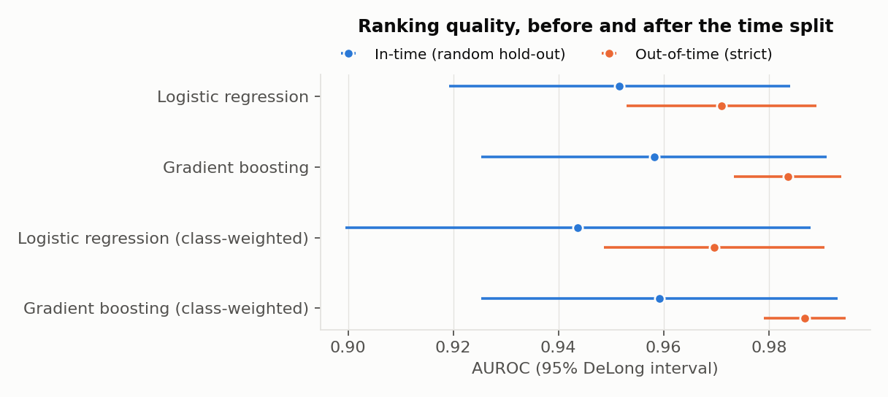
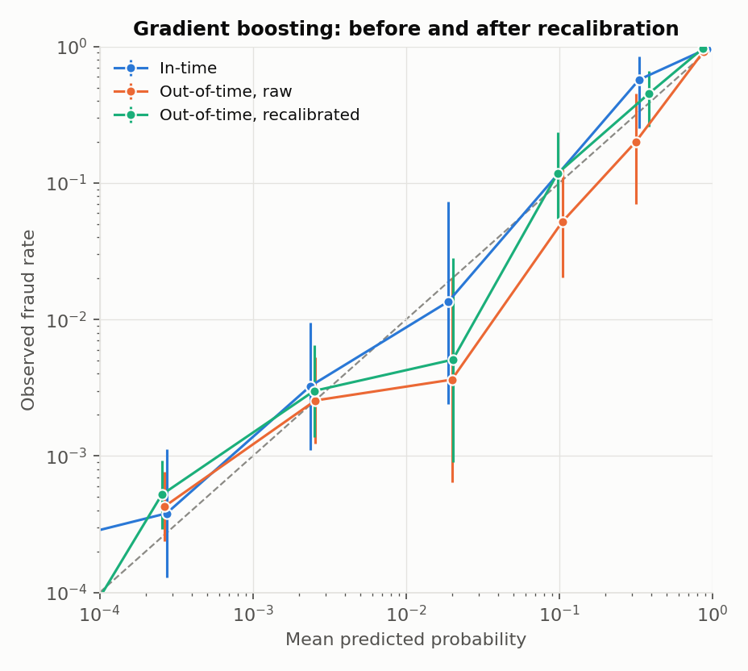
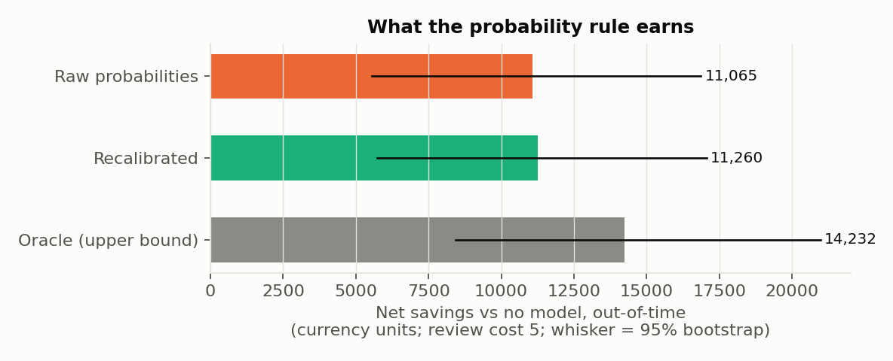

# Fraud model risk audit

**A fraud model looks good on a random hold-out. Does it still *rank* well on later transactions,
are its *probabilities* still trustworthy, and what does the difference cost?**

[](https://github.com/ahmedfawaz879/fraud-model-risk-audit/actions/workflows/ci.yml)
[](https://www.python.org/downloads/)
[](LICENSE)
[](https://docs.astral.sh/ruff/)

A reproducible model-risk audit, run end to end on the Kaggle *Credit Card Fraud Detection*
dataset. It reports discrimination and calibration **separately**, with uncertainty, before and
after a strict temporal split; attributes the drift to prior, covariate or concept shift;
translates the calibration gap into currency; and tests a recalibration on data the fix never saw.

Every verdict compares a **confidence interval** against a tolerance **declared before** the
out-of-time data is scored. The report is generated from the tables, so the prose cannot disagree
with the evidence — point it at different data and the conclusions rewrite themselves.

---

## The finding in one table

Out-of-time, on 85,117 transactions containing 107 frauds:

| Model | AUROC | Realised ÷ predicted loss | Alerts per 100k | Net savings |
|---|---|---|---|---|
| Gradient boosting *(audit subject)* | 0.984 | 0.45 | 213 | **+11,065** |
| Logistic regression | 0.971 | 0.35 | 273 | +10,438 |
| Gradient boosting (class-weighted) | **0.987** | 0.03 | 8,864 | **−23,301** |
| Logistic regression (class-weighted) | 0.970 | 0.02 | 15,237 | **−50,514** |

**The best-ranking model out-of-time is the one that loses the most money.** Class weighting buys
the top AUROC (0.987) and destroys the probability scale with it — calibration intercept −4.38,
O/E 0.038 — so a cost-derived review rule fires on 8,864 transactions per 100,000 instead of 213,
and the review bill dwarfs the fraud it prevents.

That is the entire argument for auditing calibration separately from ranking. A leaderboard
ranks these models in one order; a cost ledger ranks them in very nearly the reverse.

> The class-weighted models are in the study **on purpose**. Re-weighting classes to "fix
> imbalance" is known to preserve ranking while distorting probabilities, so their result is
> expected by construction: they demonstrate what this audit catches, they are not a finding
> about the data.

### The audited model's verdict

| Dimension | Result | Evidence |
|---|---|---|
| Ranking | **HELD** | AUROC 0.958 in-time → 0.984 out-of-time; unpaired DeLong p = 0.148 |
| Calibration | **UNCERTAIN** | O/E 0.96 [0.79, 1.16], slope 1.02 [0.93, 1.11] — the intervals straddle the tolerance |
| Money | realised loss was **0.45×** the loss the probabilities implied | 95% interval [0.19, 0.99] excludes 1.0: the provision was over-stated |
| Recalibration | **not sufficient** | gain +194 [88, 295] — real, but it did not bring calibration inside tolerance |

So the honest headline is not "the model broke." It is: **ranking held, the probabilities over-stated
expected loss by roughly a factor of two, and 107 events is not enough to call calibration either
way.** "UNCERTAIN" is a reportable answer here, not a failure to reach one — and the recommendation
the report generates says so: *gather more out-of-time events before acting.*

Meanwhile the drift itself is unmistakable: the fraud base rate halved (0.213% → 0.126%,
p < 0.001), the largest feature PSI is 1.52 on `V1`, and a classifier separates the two periods
with AUROC 0.99. The inputs moved a great deal; the model's *ranking* barely noticed.

<p align="center">
  
</p>
<p align="center">
  
  
</p>

**[→ Read the full generated report](reports/2026-11-04-kaggle-run/model_risk_audit_report.md)**
· [tables](reports/2026-11-04-kaggle-run/tables/) · [run config](reports/2026-11-04-kaggle-run/run_config.json)

---

## Method

### The split is the experiment

Rows are ordered by `Time` and cut into three consecutive periods. Nothing from a later period is
ever used to fit, tune, or choose anything for an earlier one.

| Period | Share | Rows | Frauds | Used for |
|---|---|---|---|---|
| Development | earliest 55% | 156,049 | 332 | fit the models (80%) and the **in-time** hold-out (random 20%) |
| Recalibration window | next 15% | 42,560 | 34 | the only place a recalibration may be fitted |
| **Out-of-time test** | last 30% | 85,117 | 107 | touched once, at the end, for every number that matters |

The in-time hold-out is deliberately included: it is the number a team usually reports, so the
audit can show what that number does and does not predict. `Time` itself is excluded as a feature —
under a temporal split a model can only extrapolate it. Boundaries never cut inside a block of
transactions sharing a timestamp, and exact duplicate rows are dropped **before** splitting, because
identical rows straddling a boundary are leakage no time split can prevent (1,081 were removed).

### Four questions, four sections

1. **Does it still rank?** AUROC with DeLong intervals, AUPRC with bootstrap intervals, and the
   **unpaired** DeLong test — unpaired because these are two different sets of transactions.
2. **Are the probabilities still trustworthy?** O/E, calibration-in-the-large, and calibration
   slope, each with an interval, after Van Calster et al. (2019). ECE is reported with equal-width
   *and* equal-count bins, because at a 0.2% event rate equal-width bins put nearly every score in
   bin 0 and the statistic collapses to `|mean(p) − mean(y)|`.
3. **What changed?** A two-proportion test on the base rate, per-feature PSI, and a domain
   classifier trained to tell development rows from out-of-time rows. Concept shift is what remains
   when neither of the first two explains the miscalibration.
4. **What does it cost?** Expected loss `Σ p × Amount` against realised loss, and a review rule
   that fires iff `p × Amount ≥ C` — a cutoff *derived* from costs, so it is only right if `p` is a
   real probability. Totals carry paired bootstrap intervals, and the review-cost assumption gets
   a sensitivity table.

### Then the fix has to earn its place

Three levels of updating (intercept-only, logistic slope-and-intercept, isotonic), all fitted on
the logit scale, all on the **recalibration window only**, all evaluated out-of-time. Each is
monotone, so none of them can change AUROC or the decisions of a fixed score cutoff — they move
only the decisions that depend on a probability's *level*. The primary method is declared in
advance; the other two are sensitivity checks.

---

## Quickstart

```bash
git clone https://github.com/ahmedfawaz879/fraud-model-risk-audit.git
cd fraud-model-risk-audit
pip install -e ".[dev]"

pytest                    # 134 tests, synthetic data only - no dataset needed
```

Then fetch the data (see [`data/README.md`](data/README.md)) and run the audit:

```bash
kaggle datasets download -d mlg-ulb/creditcardfraud -p data --unzip
make audit                # or: python -m fraud_audit --data data/creditcard.csv
```

Artefacts land in `audit_outputs/`: the report, 13 tables, 4 figures, and a `run_config.json`
recording the config, the environment, the data's SHA-256, and the verdicts.

### As a library

```python
from fraud_audit import AuditConfig, run_audit

cfg = AuditConfig.from_yaml("configs/credit_fraud.yaml", data_path="data/creditcard.csv")
result = run_audit(cfg)
result.save("audit_outputs")

print(result.verdicts.ranking)              # HELD
print(result.verdicts.calibration_headline) # UNCERTAIN (interval straddles the tolerance)
print(result.money["prov_raw"])             # 0.451...
```

### Changing the assumptions

Everything a reviewer might challenge lives in [`configs/credit_fraud.yaml`](configs/credit_fraud.yaml) —
split fractions, the model under audit, the review cost, the bootstrap size, and the tolerances.
Common overrides have flags:

```bash
python -m fraud_audit --review-cost 25 --subject "Logistic regression" --n-boot 2000
python -m fraud_audit --config configs/credit_fraud.yaml --output runs/strict --no-figures
```

Exit codes: `0` success, `2` a configuration or data-path problem.

---

## Repository layout

```
src/fraud_audit/
├── config.py       typed config + YAML loading; rejects unknown keys
├── data.py         load, validate, de-duplicate, SHA-256 fingerprint
├── split.py        the strict temporal split and the invariant it enforces
├── integrity.py    decidable leakage checks + cross-split duplicate detection
├── models.py       the four models; the subject is declared, not chosen
├── metrics.py      O/E, CITL, slope, equal-mass ECE, Wilson, DeLong, bootstrap
├── drift.py        prior shift, PSI, domain classifier
├── money.py        provisioning, the p x Amount rule, tuned cutoffs, paired bootstrap
├── recalibrate.py  intercept / logistic / isotonic, all on the logit scale
├── evaluate.py     table builders - evidence only, no judgements
├── report.py       the verdict rules and the generated Markdown
├── plots.py        four figures, one palette
├── pipeline.py     orchestration; AuditResult.save() writes everything
└── cli.py          python -m fraud_audit

configs/            the full parameter set, in YAML
tests/              134 tests, all on synthetic data with known answers
reports/            a committed reference run: report, tables, figures
docs/               what the upstream toolkit was missing and why
```

### Testing philosophy

The suite runs entirely on **synthetic data with a planted truth**, so it needs no download and
runs in CI on every push. A self-test is only meaningful when you know the right answer in advance:

* a perfectly calibrated sample must score O/E ≈ 1, CITL ≈ 0, slope ≈ 1;
* a planted `logit + 1` shift must surface as CITL ≈ −1; a planted `2 × logit` must halve the slope;
* DeLong's standard error must agree with a bootstrap standard error computed independently;
* every recalibrator must repair a known distortion and leave AUROC alone;
* the four-transaction money example is checked against **arithmetic done on paper**;
* the drift diagnostics must find a shift deliberately planted in `V1` — and a negative control
  must report a drift-free period as stable;
* the split must reject unsorted input, overlapping periods, and any row that reaches both the
  fit set and an evaluation set.

---

## What this audit does not claim

* **48 hours of data.** This tests short-term drift only — not seasonal, not adversarial drift
  over months.
* **No entity id.** Cards cannot be identified, so the bootstrap resamples rows. If one card
  contributes many rows, the intervals are too narrow.
* **Anonymised features.** `V1..V28` are PCA components; drift cannot be explained in business terms.
* **107 out-of-time frauds.** Amount-weighted quantities depend on a handful of large frauds and
  carry wide intervals. This is why the calibration verdict is UNCERTAIN rather than a pass.
* **The cost model is an assumption**, not a measurement: a review costs `C`, a reviewed fraud is
  always stopped, an unreviewed fraud costs its full amount, customer friction and chargeback fees
  are ignored. The sensitivity table varies `C` from 1 to 25.
* **Tolerances are illustrative.** A real model-risk owner sets them; the point is that they were
  fixed *before* the out-of-time data was scored.
* **One split, one seed.** The models' optimisation variance is not included.

---

## Built on

[`cmvt`](https://github.com/ahmedfawaz879/clinical-model-validation-toolkit) — a validation toolkit
for clinical prediction models — supplies DeLong AUROC variance and the unpaired DeLong test,
equal-width ECE, the decidable leakage checks, and PSI. Building this audit surfaced six gaps in
it, each implemented here in the meantime and written up in
[`docs/toolkit-gaps.md`](docs/toolkit-gaps.md).

The method is the same one used for an adult-to-paediatric chest-X-ray transfer study, applied to
non-clinical data: report discrimination and calibration separately, with uncertainty, before and
after a strict split; diagnose what changed; price it; and test the fix on data the fix never saw.

**Key references**

* Van Calster B, McLernon DJ, van Smeden M, Wynants L, Steyerberg EW. *Calibration: the Achilles
  heel of predictive analytics.* BMC Medicine 2019;17:230.
* Steyerberg EW. *Clinical Prediction Models.* Springer, 2nd ed. — the updating hierarchy used
  for recalibration.
* DeLong ER, DeLong DM, Clarke-Pearson DL. *Comparing the areas under two or more correlated
  receiver operating characteristic curves.* Biometrics 1988;44:837–845.
* Dal Pozzolo A, Caelen O, Johnson RA, Bontempi G. *Calibrating probability with undersampling for
  unbalanced classification.* IEEE SSCI 2015. — the source of the dataset.

## Citation

See [`CITATION.cff`](CITATION.cff), or:

> Fawaz, A. (2026). *Fraud model risk audit: discrimination, calibration and cost under a strict
> temporal split* (v0.1.0). https://github.com/ahmedfawaz879/fraud-model-risk-audit

## Licence

[MIT](LICENSE) © 2026 Ahmed Fawaz. The dataset is **not** redistributed here; it is licensed
separately under [ODbL v1.0](https://opendatacommons.org/licenses/odbl/1-0/) by its authors.
